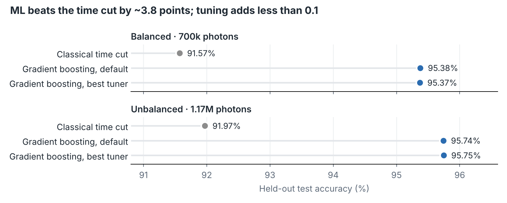
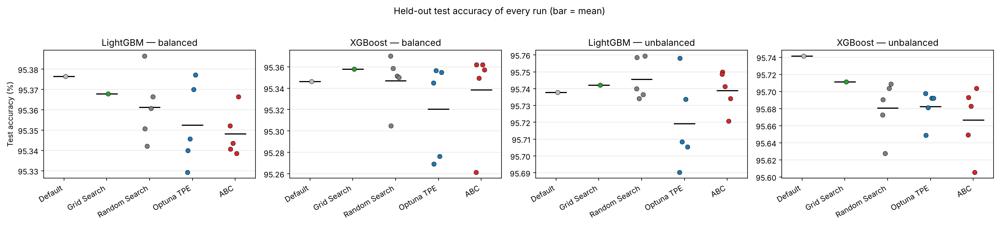
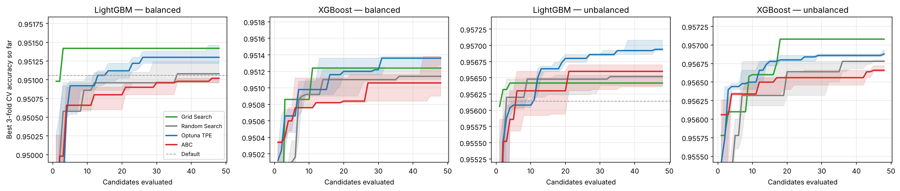

# 🐝 Cherenkov / Scintillation Photon Separation with ABC Hyperparameter Optimization

**Does the Artificial Bee Colony (ABC) algorithm find better hyperparameters than Grid Search, Random Search or Optuna TPE when separating Cherenkov from scintillation light in a neutrino detector, under an identical evaluation budget?**


[](https://pypi.org/project/abcopt/)




## ✨ Highlights

- **Machine learning beats the classical time cut by ~3.8 percentage points** (91.6% → 95.4% balanced, 92.0% → 95.7% unbalanced; F1 0.869 → 0.929 on the unbalanced set).
- **Hyperparameter tuning barely matters here.** Every tuned model ends within 0.08 points of the default settings. The landscape is flat: 36–49% of random configurations land within 0.25 points of the best score ever found.
- **No tuner generalizes better than another.** Optuna TPE wins the search objective most often, but on the held-out test set ABC, Random Search and TPE are statistically indistinguishable (Mann–Whitney U, all p ≥ 0.22).
- **No leakage from photon-level splitting.** A contiguous-block split gives the same accuracy as a random split to within 0.005 points.
- **ABC is reference-exact.** All ABC runs use [abcopt](https://github.com/yusufkorkmazyigit/abc-optimizer-lib) ≥ 0.2.1, which reproduces the Erciyes University reference implementation of Karaboğa's canonical ABC step for step.

## Contents

- [Problem](#-problem)
- [Data](#-data)
- [Protocol](#-protocol)
- [Results](#-results)
- [Robustness checks](#-robustness-checks)
- [Discussion](#-discussion)
- [Reproduce](#-reproduce)
- [Repository layout](#-repository-layout)
- [Context and citation](#-context-and-citation)

## 🔭 Problem

In a hybrid **water-based liquid scintillator (WbLS)** detector, each event produces two kinds of light: a small, prompt, directional **Cherenkov** signal and a much larger, slower, isotropic **scintillation** signal. Separating them photon by photon recovers direction information (from Cherenkov light) while keeping the energy resolution of scintillation, a goal of hybrid-detector R&D such as the EOS and ANNIE WbLS programmes.

The classical approach is a **time cut**: photons arriving before a threshold are labelled Cherenkov. Earlier work in our group showed that gradient-boosted classifiers do clearly better. This study asks the next question: **how much does hyperparameter optimization add, and is a swarm-intelligence optimizer (ABC) better at it than standard methods?**

## 📦 Data

Geant4 simulation of a hybrid WbLS detector by the Erciyes Neutrino Research Group (ENRG). Each row is one detected photon.

| Dataset | Photons | Cherenkov share |
|---|---:|---:|
| Balanced | 700,000 | 50.0% |
| Unbalanced | 1,167,380 | 30.1% |

**Features:** PMT number, hit time (ns), photon energy (eV). **Target:** `isCherenkov`.

> **The simulation data is not part of this repository.** It belongs to ENRG; see [`data/README.md`](data/README.md) for the expected file format.

## 🧪 Protocol

| Step | Setting |
|---|---|
| Models | XGBoost and LightGBM, six hyperparameters each |
| Methods | Default settings, Grid Search, Random Search, Optuna TPE, ABC |
| Budget | **48 candidates per run**, identical for every method |
| Search objective | 3-fold stratified CV accuracy on a fixed 50,000-photon subsample of the training set, same folds for every method |
| Final evaluation | Best configuration refit on the full training set, scored once on a fixed stratified 20% held-out test set |
| Repetitions | Random Search, TPE and ABC with 5 seeds each; Grid Search (3×2×4×2 grid) is deterministic and runs once |
| ABC settings | `ABCSearchCV(pop_size=8)`, default `limit` |

<details>
<summary>Search spaces</summary>

| XGBoost | Range | LightGBM | Range |
|---|---|---|---|
| `learning_rate` | 0.01–0.3 (log) | `learning_rate` | 0.01–0.3 (log) |
| `n_estimators` | 100–600 | `n_estimators` | 100–600 |
| `max_depth` | 3–12 | `num_leaves` | 15–255 |
| `min_child_weight` | 0.5–20 (log) | `min_child_samples` | 5–100 |
| `subsample` | 0.5–1.0 | `subsample` | 0.5–1.0 |
| `reg_lambda` | 0.001–10 (log) | `reg_lambda` | 0.001–10 (log) |

</details>

## 📊 Results

**Held-out test accuracy (%)**, mean over runs (5 seeds for stochastic methods):

| Dataset | Model | Time cut | Default | Grid | Random | Optuna TPE | ABC |
|---|---|---:|---:|---:|---:|---:|---:|
| Balanced | XGBoost | 91.57 | 95.35 | 95.36 | 95.35 | 95.32 | 95.34 |
| Balanced | LightGBM | 91.57 | 95.38 | 95.37 | 95.36 | 95.35 | 95.35 |
| Unbalanced | XGBoost | 91.97 | 95.74 | 95.71 | 95.68 | 95.68 | 95.67 |
| Unbalanced | LightGBM | 91.97 | 95.74 | 95.74 | 95.75 | 95.72 | 95.74 |

Every run, per setting (the whole vertical axis spans about 0.1 points):



Best CV accuracy found so far during the search (median and interquartile range over seeds):



Search time is similar across tuners: on average about 75–100 s per run for XGBoost and 150–215 s for LightGBM on 2 CPU cores. All tables, statistical tests and the flat-landscape analysis are in [`analysis.ipynb`](analysis.ipynb).

## 🛡️ Robustness checks

**Photon-level leakage.** The data has no event IDs, so a random split can put photons from the same simulated event on both sides. The unbalanced file is stored in simulation order, so splitting it into **contiguous blocks** keeps most events on one side ([`leakage_check.py`](leakage_check.py)):

| Split | XGBoost | LightGBM |
|---|---:|---:|
| Random (stratified) | 95.741% | 95.738% |
| Contiguous blocks (5-fold) | 95.739% | 95.735% |

**Implementation correctness.** An earlier run with abcopt 0.2.0, whose onlooker probabilities followed `fit_i / Σ fit` instead of the reference code's `0.9 · fit_i / max(fit) + 0.1`, suggested that ABC generalizes slightly better than TPE. With the reference-exact implementation the effect disappears, so it was noise. Those earlier results are kept in [`results/v0.2.0/`](results/v0.2.0/) for transparency.

## 💬 Discussion

With only three photon-level features, accuracy is limited by how much the two light populations overlap in feature space, not by the classifier's settings. On such a flat landscape no search strategy can make a meaningful difference, and winning the CV objective does not carry over to the test set. For XGBoost on the unbalanced set, the defaults are even slightly better than every tuned model: settings chosen on a 50,000-photon subsample do not fully transfer to a model trained on 930,000 photons.

The remaining room for improvement therefore lies in **more informative inputs**, for example event-level context or neighbouring hits, rather than in hyperparameter optimization.

**Limitations:** a single train/test split, three features and a 48-candidate budget; search on a subsample; five seeds per stochastic method (smallest attainable p-value 0.008) with no correction for multiple comparisons.

## ▶️ Reproduce

```bash
git clone https://github.com/yusufkorkmazyigit/cherenkov-abc-hpo.git
cd cherenkov-abc-hpo
pip install -r requirements.txt
# place the two CSV files in ./data (see data/README.md)
python experiment.py        # about 3 h on 2 CPU cores, resumable
python leakage_check.py
jupyter notebook analysis.ipynb
```

`experiment.py` appends every run to `results/*.jsonl` and skips runs that are already there, so an interrupted run can be restarted. `N_JOBS` and `DATA_DIR` can be set as environment variables. The notebook only needs the data for the time-cut baseline; every other table and figure is computed from `results/`.

## 🗂️ Repository layout

| Path | Content |
|---|---|
| `experiment.py` | The benchmark: all methods, models and seeds |
| `leakage_check.py` | Random vs contiguous-block split |
| `analysis.ipynb` | Tables, Mann–Whitney tests, figures and discussion |
| `results/` | Raw results of every run (scores and chosen hyperparameters, no data) |
| `results/v0.2.0/` | Earlier ABC runs with abcopt 0.2.0 |
| `figures/` | Figures used in this README |
| `data/` | Place for the (not included) simulation data |

## 📚 Context and citation

Part of the TÜBİTAK 2209-A project *Optimization of Cherenkov and Scintillation Photon Discrimination Machine Learning Models using the Artificial Bee Colony (ABC) Algorithm*, Erciyes University (advisor: Assoc. Prof. Dr. Emrah Tıraş).

- abcopt: [github.com/yusufkorkmazyigit/abc-optimizer-lib](https://github.com/yusufkorkmazyigit/abc-optimizer-lib) · [PyPI](https://pypi.org/project/abcopt/)
- Tıraş, E. et al. (2024), [arXiv:2406.09191](https://arxiv.org/abs/2406.09191)
- Karaboğa, D. (2005). *An Idea Based on Honey Bee Swarm for Numerical Optimization*, Technical Report TR06, Erciyes University

If you use this code, please cite it via [`CITATION.cff`](CITATION.cff).

## License

Code: [MIT](LICENSE). The simulation data is not included and is not covered by this license.

---

<sub>Developed by [Yusuf Korkmazyiğit](https://github.com/yusufkorkmazyigit), Computer Engineering, Erciyes University · Erciyes Neutrino Research Group.</sub>
